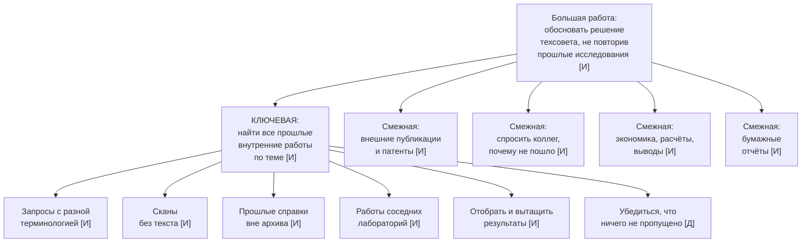

# Граф работ и карта сегментов «Сноски»

По итогам интервью замысел смещён. Работа из ДЗ-2 «подтвердить источником каждое утверждение» не подтвердилась ни в одном интервью: отдельный инструмент для прослеживаемости источников не востребован ни студентом, ни исследователем: её закрывают привычные средства. Сильнее всего повторялась B2B-работа: найти, что компания уже делала по теме, чтобы не повторять исследования. Граф построен вокруг неё.

**Обозначения.** **[И]** — услышано в интервью, в скобках файл расшифровки и номер вопроса по порядку; **[Д]** — достроено мной. Все B2B-интервью проведены с моделями (живого собеседника из научно-технического центра найти не удалось): `live-b2b` — основное, Claude Opus 5.5; `b2b-1` — Gemini 3.8 Flash; `b2b-2` — Claude Opus 5.5 с краткой ролью.

## Граф работ по итогам интервью

| Уровень | Работа | Происхождение |
|---|---|---|
| Большая работа — ради чего | Обосновать решение техсовета об открытии проекта НИОКР так, чтобы компания не профинансировала повтор уже проведённого исследования | [И] `live-b2b` в. 8–9, `b2b-1` в. 8–9, `b2b-2` в. 8–9 |
| Ключевая работа — что продукт выполняет целиком | **Найти все прошлые внутренние работы компании по теме** — отчёты о НИР и прошлые справки, включая те, что не находятся поиском по названию | [И] `live-b2b` в. 2, 9, 11; `b2b-2` в. 2–3, 9, 11; противоречит `b2b-1` в. 3 — там поиск по архиву работает |
| Смежные работы — того же уровня, продуктом не выполняются | 1. Собрать внешние публикации и патенты по теме | [И] `live-b2b` в. 2, `b2b-1` в. 2, `b2b-2` в. 2 |
| | 2. Выяснить у коллег и производственников, почему прошлые испытания не пошли дальше и какие у цеха ограничения | [И] `live-b2b` в. 3, `b2b-1` в. 11 |
| | 3. Оценить затраты и экономику варианта | [И] `live-b2b` в. 6, `b2b-2` в. 4 |
| | 4. Проверить расчётом цифры внешнего предложения (материальный баланс, термодинамика) | [И] `b2b-1` в. 6–7 |
| | 5. Сформулировать выводы о применимости к своему сырью | [И] `live-b2b` в. 4 |
| | 6. Уточнить у заказчика справки, какой вопрос он на самом деле решает | [И] `b2b-2` в. 11 |
| | 7. Найти отчёты, которые существуют только на бумаге | [И] `b2b-1` в. 9 |
| Микроработы — из чего состоит ключевая | 1. Подобрать запросы с учётом того, что одно и то же в разные годы называли по-разному | [И] `live-b2b` в. 2 |
| | 2. Найти отчёты-сканы без распознанного текста и с общими названиями в карточке | [И] `live-b2b` в. 9, `b2b-2` в. 3 |
| | 3. Найти прошлые справки, которые в архив не регистрируют и которые лежат в почте и на сетевых дисках | [И] `live-b2b` в. 11, `b2b-2` в. 9, 11 |
| | 4. Найти работы смежных лабораторий и отделов по той же теме | [И] `live-b2b` в. 9, `b2b-2` в. 9 |
| | 5. Отобрать действительно относящиеся к теме (из ~15 найденных — 2–4) | [И] `b2b-1` в. 3 |
| | 6. Вытащить из отчёта исходные данные, результаты и отрицательные выводы | [И] `live-b2b` в. 3, `b2b-1` в. 3 |
| | 7. Записать инвентарный номер отчёта, чтобы сослаться на него в справке | [И] `live-b2b` в. 5, `b2b-1` в. 5 |
| | 8. Убедиться, что ничего важного не пропущено | [Д] — в интервью не звучало как отдельное действие, вывод из историй о повторах |

## Критическая цепочка

Развёрнута по основному B2B-интервью (`live-b2b`), с дополнениями из `b2b-1` и `b2b-2`. Время — по ответам респондентов.

| Шаг | Что делает | Чем пользуется | Обрыв / переключение? |
|---|---|---|---|
| 1 | Получает поручение подготовить справку к техсовету, срок около двух недель | Почта | **Обрыв:** поручение одной строкой, что на самом деле нужно заказчику, становится ясно в конце (`b2b-2` в. 11) |
| 2 | Ищет внутренние отчёты по теме | Электронный архив отчётов о НИР | **Обрыв:** поиск только по названию и ключевым словам; разные термины в разные годы, сканы без текста (`live-b2b` в. 2, 9; `b2b-2` в. 3 — 40 минут без результата). У `b2b-1` в. 3 поиск работает — допущение спорное |
| 3 | Спрашивает коллег-старожилов, кто этим занимался | Разговор, телефон | **Переключение** с архива на людей: коллега называет год и номер темы, после этого отчёт находится (`b2b-2` в. 3) |
| 4 | Ищет прошлые справки по смежным темам | Личные папки, почта, сетевые диски соседних отделов | **Обрыв:** справки в архив не регистрируют, о чужих справках узнают случайно (`live-b2b` в. 11, `b2b-2` в. 9) |
| 5 | Поднимает бумажные отчёты | Техническая библиотека завода | **Переключение** на бумагу, только если кто-то вспомнил (`b2b-1` в. 9) |
| 6 | Собирает внешние статьи и патенты | ScienceDirect, Google Scholar, eLibrary, ФИПС, Espacenet, Яндекс Переводчик | **Переключение** между 5–6 сервисами; часть статей вне подписки — заказ через библиотеку или у авторов (`live-b2b` в. 7) |
| 7 | Читает отобранное и сводит в таблицу — 2–4 дня | Excel | Нет — привычный рабочий шаг во всех трёх интервью |
| 8 | Выясняет, почему прошлые испытания не пошли и какие ограничения у цеха | Звонок коллеге, разговор с технологами цеха | **Переключение** с документов на людей: главное знание в отчётах не записано (`live-b2b` в. 3, `b2b-1` в. 11) |
| 9 | Пишет текст и выводы — около 3–4 дней | Word, PowerPoint | Нет обрыва, но самый трудный шаг — выводы о применимости к своему сырью (`live-b2b` в. 4) |
| 10 | Вносит правки руководителя | Word, Excel | **Обрыв:** просьба добавить экономику, которой нет в открытых источниках, — два дня и ожидание ответа экономистов (`live-b2b` в. 6) |
| 11 | Докладывает на техсовете, отвечает на вопросы по цифрам | Справка со ссылками на инвентарные номера | Нет — ссылки выручают в одном-двух вопросах (`live-b2b` в. 5, `b2b-1` в. 5) |
| 12 | Справка остаётся у автора и руководителя | Личная папка, почта | **Обрыв для следующего исследователя:** справка не попадает в архив и не найдётся в следующий раз — цепочка замыкается на шаг 4 (`live-b2b` в. 11) |

Продукт закрывает обрывы на шагах 2, 4 и 12 и сокращает переключение на шаге 3. Шаги 5, 8 и 10 остаются за человеком.

## Карта сегментов

Сегменты выделены по работе и критериям успеха. Все три — люди, которые ищут уже сделанное по теме, но с разной целью и разными критериями.

| Параметр | Сегмент 1. Найти прошлые внутренние работы перед запуском НИОКР | Сегмент 2. Проверить внешнее предложение на реалистичность | Сегмент 3. Войти в новую научную область |
|---|---|---|---|
| Описание: работы и критерии успеха | Исследователь научно-технического центра готовит справку к техсовету. Критерии: ни одного пропущенного внутреннего отчёта или справки по теме; справка за дни, а не недели; у каждого факта — инвентарный номер | Исследователь проверяет предложение подрядчика или внешнего института перед техсоветом. Критерии: найти несостыковки заявленных показателей с внутренним и мировым опытом до заседания; каждое возражение подкреплено источником или расчётом | Студент или молодой исследователь начинает работу в незнакомой теме. Критерии: за неделю получить «костяк» из 10–20 ключевых работ и понять, куда двигаться; заметки, к которым можно вернуться |
| Размер — сколько таких людей | Порядок — 10⁴ человек в 500–850 организациях. В предпринимательском секторе около 1,4 тыс. организаций, выполняющих исследования, из них 531 — промышленные и 323 — отраслевые НИИ; исследователей в секторе 175,1 тыс. (ИСИЭЗ НИУ ВШЭ, 2024). Справки пишут ведущие сотрудники — допускаю 10–15% исследователей, то есть 15–25 тыс. [Д] | Порядок — 10³ человек в тех же организациях: та же роль, но работа поручается реже [Д] | Порядок — 10⁵ человек: 4,11 млн студентов вузов (BusinesStat, 2024), из них в научных группах и исследовательской магистратуре допускаю 5–10% [Д], плюс 339 тыс. исследователей (ИСИЭЗ, 2024) |
| Частота работы | 3–7 раз в год на человека: 3–4 большие справки и до 2–3 малых (`live-b2b` в. 10, `b2b-1` в. 10, `b2b-2` в. 10), плюс при старте каждого своего проекта [Д] | 1–2 раза в год на человека [Д]; в интервью — один случай из трёх (`b2b-1`) | 1–3 раза в год: статья, курсовая, ВКР (`live-b2c`) [Д] |
| Бюджет работы — сколько уже тратят | Время: 7–9 рабочих дней на большую справку (`live-b2b` в. 4, `b2b-1` в. 4, `b2b-2` в. 4); при стоимости дня ведущего инженера 8–10 тыс. ₽ с налогами [Д] — 60–90 тыс. ₽ за справку. Повтор исследования — от недели до двух месяцев работы лаборатории (`live-b2b` в. 9, `b2b-1` в. 9, `b2b-2` в. 9). Компания уже платит за подписки на журналы и расчётные программы и внедряет корпоративного ИИ-ассистента (`live-b2b` в. 7, `b2b-1` в. 7) | 1–2 дня времени исследователя (`b2b-1` в. 6), но на кону — решение об инвестиции в установку [Д] | Около 2100 ₽ в месяц на универсальные ИИ-подписки — Claude и Gemini (`live-b2c`, уточнение после интервью); модели-респонденты не платят ничего (`synthetic-b2c-1`, `synthetic-b2c-2`) |
| Достижимость — можем ли дотянуться | Низкая–средняя. Покупает директор по R&D с согласованием ИБ, цикл сделки долгий; живого собеседника для ДЗ-3 найти не удалось. Канал входа — корпоративные хакатоны промышленных компаний (опыт участия в хакатоне металлургической компании, июль 2026) и отраслевые конференции [Д] | Низкая–средняя — тот же покупатель и те же каналы, что у сегмента 1 [Д] | Высокая: студенческие научные группы, Telegram-каналы, свой вуз (`live-b2c` — респондент для живого интервью нашёлся в своём окружении) |
| Возможность создать ценность | Высокая там, где поиск по архиву слабый: распознать сканы, искать по смыслу, а не по названию, включить в поиск прошлые справки. Под вопросом: у `b2b-1` архив работает хорошо; бумажные отчёты и знания в головах продукт не закроет | Средняя: продукт найдёт прошлые испытания и данные, но главное — инженерный расчёт (`b2b-1` в. 6–7) — делает человек | Низкая: студент уже решает задачу агентом на универсальной модели и доволен результатом (`live-b2c`) |
| Конкуренция | Встроенный поиск архива, внутренний корпоративный ИИ-ассистент (`live-b2b` в. 7), память коллег-старожилов (`live-b2b` в. 3, `b2b-2` в. 3), интеграторы корпоративного поиска [Д]. Внешние ИИ-сервисы закрыты политикой ИБ (`live-b2b` в. 7, `b2b-1` в. 7) | Опыт экспертов, расчётные программы, внешние консультанты [Д] | Claude, Gemini, ChatGPT, DeepSeek, Connected Papers, Semantic Scholar (`live-b2c`, `synthetic-b2c-1`, `synthetic-b2c-2`) — сильная и бесплатная или уже оплаченная |

## Обоснование выбора целевого сегмента

Целевой — **сегмент 1: исследователи научно-технических центров, которым перед запуском НИОКР нужно найти прошлые внутренние работы по теме.**

1. **Как мы создаём для них ценность?** Сейчас прошлые работы ищут поиском по названию и по памяти коллег (шаги 2–3 цепочки), а прошлые справки не ищутся совсем (шаг 4). Продукт находит отчёты по смыслу текста, а не по названию, распознаёт сканы, индексирует прошлые справки и сам добавляет в индекс каждую новую — это закрывает обрыв на шаге 12. Результат — список работ с инвентарными номерами и фрагментами, где сказано главное, включая отрицательные результаты. Работает внутри контура компании, поэтому не упирается в запрет ИБ на внешние сервисы.
2. **Как мы на них зарабатываем?** Платит компания из бюджета НИОКР: разовая плата за внедрение (подключение архива, распознавание сканов, индексация) и годовая лицензия на научно-технический центр. Ориентир цены — экономия времени: при 15–30 авторах справок в центре [Д], 5–7 справках в год на автора и экономии хотя бы двух дней на каждой выходит 150–420 рабочих дней, то есть 1,2–4 млн ₽ в год [Д]; один предотвращённый повтор исследования окупает больше. Внедрение у каждого заказчика своё и дорогое, поэтому его нужно продавать отдельно; сходимость с затратами проверю в ДЗ-6.
3. **Как создаём спрос и растём внутри сегмента?** Вход — через директора по R&D или руководителя лаборатории, первый шаг — пилот на архиве одной лаборатории: взять прошлую справку и показать, что продукт нашёл, чего не нашёл автор. Рост — от лаборатории к центру, от центра к другим центрам холдинга. Каналы — корпоративные хакатоны промышленных компаний, отраслевые конференции, интеграторы, которые уже работают с промышленностью. 500–850 организаций — достаточно для нишевого B2B-продукта.

**От чего отказались и почему:**

- **Сегмент 3 (B2C, войти в новую область)** — студент уже решает эту работу универсальными ИИ-агентами, за которые платит сам, и доволен результатом; соревноваться с ними продуктом на своей модели бессмысленно. Повод из паспорта — научный руководитель с вопросом «откуда это?» — не встретился ни в живом интервью, ни у моделей.
- **Сегмент 2 (проверить внешнее предложение)** — работа реальна, но редкая, и её главная часть — инженерный расчёт, который продукт не делает. Покупатель тот же, что у сегмента 1, поэтому сегмент можно добавить позже как расширение.
- **Ключевая работа ДЗ-2 «подтвердить источником каждое утверждение»** — отдельный инструмент для прослеживаемости не востребован ни в одном интервью: её закрывают столбец в Excel, Zotero или память автора.

**Главный риск выбора:** все B2B-данные получены от моделей, и модели расходятся в главном — работает ли поиск по архиву. Первое, что нужно сделать, — проверить это допущение с живым сотрудником научно-технического центра.
